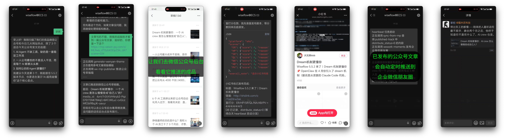
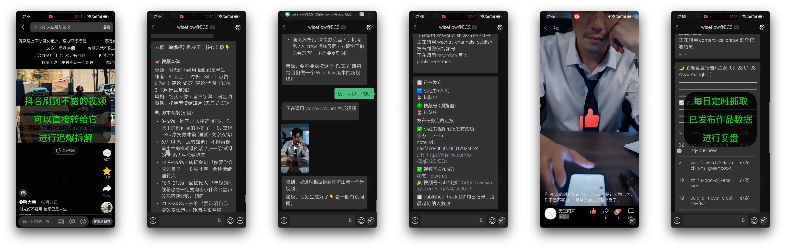

# 小贝（xiaobei）

小贝（xiaobei）是为OPC/中小微企业量身打造的自媒体获客智能体，底层架构基于 [openclaw](https://github.com/openclaw/openclaw)，目前它能帮你：

- 微信公众号文章写作、排版与推送
- 小红书/小绿书图文创作与发布
- 抖音图文音乐发布，支持多图上传与推荐配乐
- 图文海报与原创配乐生成
- 视频生成与多平台分发（支持视频号、抖音、小红书、快手、TikTok、微博……）
- 低成本口播视频制作：幻灯片、剪纸动画、操作录屏 B-roll，支持自定义音色与数字人小窗
- Twitter/X、微博、知乎等平台发文
- 微信朋友圈内容发布（通过企业微信接口）
- 爆款视频下载分析、仿写与再创作（支持抖音、快手、小红书等平台视频链接）
- 赛道头部账号DNA级复刻（目前支持小红书、微信视频号、抖音、微信公众号四个平台）
- 已发布作品数据监控与每日定时复盘
- 自媒体评论区获客与站内私信联络（支持小红书、抖音等平台）
- 7*24 小时智能客服（售前接待）
- 通过社交媒体寻找潜在客户，查询小红书蒲公英达人合作与千帆分销商资料
- 信息搜集、竞对监控与市场调研：支持小红书、抖音、微博、知乎、快手、TikTok、B站、Twitter/X、YouTube、微信公众号、LinkedIn、Reddit、新闻、政务、财经、学术、购物、GitHub 等信源，扩展商业、技术/AI、学术、招聘、口碑和设计六类站点
- "四声分析"法战略研判与讨论
- 产品deck、ppt制作，投资/IR 材料准备
- 网站设计与制作、ICP 备案等材料辅助
- ……

并且你只需通过手机上的微信与他沟通，即可实现全部功能！（同时支持飞书、企业微信）





xiaobei 由Wiseflow (原AI首席情报官）作者 bigbrother666sh 开发。

官网：[openclaw-for-business.com](https://openclaw-for-business.com/)

---

## 🚀 **V5.8.0 更新**

- **OpenClaw 基座升级至 2026.10.4**，同步更新插件接入、配置与安装升级流程；
- **全新小贝浏览器**：基于 Camoufox 构建独立的 `xiaobei-browser` 插件，接入 OpenClaw 原生插件体系，统一管理浏览器身份与持久会话；扫码、验证码等待期间保留窗口，大幅提升登录与自动化操作体验；
- **更聪明的 IT Engineer 帮你保驾护航**：优化预置记忆与工作指南，将日常使用中的运维经验沉淀为技能，完善日志巡检、定时任务、插件与会话维护，让系统排障和日常运维更省心；
- **视频制作与验收升级**：数字人改用 Wan S2V，支持按原声分段生成与口型审查；百炼业务空间 TTS 默认升级到 3.1 Plus。补齐画面方案校验、剪辑节奏与素材复用检查、字幕和尾帧检查，支持保留已认可的原音轨；
- **多平台发布更稳**：优化抖音双封面、草稿续编与发布结果核对，小红书话题校验、转码状态与提交结果追踪；发布结果未知时先核查，防止重复提交；
- **获客与客服完善**：小红书私信增加已读状态校验与自动回复去重；Awada Channel 增强语音转写、网盘文件发送与客户资料联动，过滤框架故障和模型回退提示，减少对客户的干扰；
- **安装升级体验优化**：完善 AtomGit 国内线路、GitHub 下载代理、资源断点续传与失败重试，补齐 Windows 安装和日志排障指引；幻灯片、卡片、PPT 等工具共用一套 Playwright/Chromium 渲染环境，统一预装依赖。

> **升级提示**：5.8.0 相对于 5.7.x、5.6.x 均为**破坏性升级**。建议老用户先将个性化配置和记忆数据备份到 `~/.openclaw` 目录之外，再删除本机的 `~/.openclaw` 目录并全新安装；也可在完成备份后，为安装脚本添加 `--force` 参数，强制覆盖原有配置（Windows PowerShell 安装请先设置 `$env:XIAOBEI_FORCE="1"`）。

**成品展示见小贝的微信视频号和小红书号**：[查看作品](https://openclaw-for-business.com/media)

详见 [CHANGELOG.md](CHANGELOG.md)

---

## 🌟 快速开始

### 0. 准备 API Key

推荐开通 [阿里云百炼「Token Plan」套餐](https://www.aliyun.com/benefit/ai/aistar?clubBiz=subTask..12766005..10274..)——一个套餐覆盖**思考与对话、图像生成、TTS 语音合成、ASR 语音识别和视频生成**全部大模型能力，无需为这些能力分别准备其他供应商账号或 Key。

> 💡 **套餐选择**：前期熟悉安装可选 **Lite 版 39 元/月**；正常使用建议 **Standard 版 139 元/月**。

> 🎬 **想用视频生成能力？** 默认使用百炼Token Plan内的 wan3.0 或者 happyhorse 1.1；配置 `MODELSTUDIO_API_KEY` 和 `WORKSPACE_ID` 后，使用百炼业务空间的 Wan3.0。

> 视频生成还支持火山 Seedance 和 MiniMax H3，详见下方[视频生成模型配置](#-视频生成模型配置)。

### 推荐：一键脚本安装（预构建 tarball 路线）

**macOS / Linux（bash，一行命令）：**

```bash
# GitHub 线路（适合能正常访问 GitHub 的网络环境）
bash -c "$(curl -fsSL https://raw.githubusercontent.com/TeamWiseFlow/xiaobei/master/scripts/install.sh)"
# 国内推荐：AtomGit 线路
bash -c "$(curl -fsSL https://raw.atomgit.com/wiseflow/xiaobei/raw/master/scripts/install-atomgit.sh)"
```

**Windows（PowerShell）：**

> **Windows 用户请以管理员身份运行 PowerShell 再安装**（右键 PowerShell → "以管理员身份运行"）。
> 原因：安装过程中创建 NTFS 符号链接需要管理员权限（或开启开发者模式）；非管理员也能装，软链失败会自动回退拷贝。

```powershell
# GitHub 线路（适合能正常访问 GitHub 的网络环境）
irm https://raw.githubusercontent.com/TeamWiseFlow/xiaobei/master/scripts/install.ps1 | iex
# 国内推荐：AtomGit 线路
irm https://raw.atomgit.com/wiseflow/xiaobei/raw/master/scripts/install-atomgit.ps1 | iex
```

> 按网络环境选一条线路：能正常访问 GitHub 可用 `install.sh` / `install.ps1`；国内客户推荐 AtomGit 预构建 tarball 配合 `XIAOBEI_GITHUB_PROXY`，客户端无需完整构建 OpenClaw。两条线路安装产物一致。

> `XIAOBEI_GITHUB_PROXY` 可设为其他 HTTPS URL 前缀；不设置时 GitHub 下载保持直连。它覆盖浏览器、指纹模型、Matrix 原生库及安装期间的 GitHub Git 拉取；代理模式还为未自定义的 npm/pnpm、Node headers 和 Playwright 下载配置国内镜像。正式 tarball 已内置 uBlock 和 GeoIP，安装时无需从 Mozilla 或 GeoIP 上游下载；源码或旧包的回退下载、系统包管理器及非 GitHub 的可选依赖仍按各自来源访问。完整范围与覆盖配置见 [安装脚本说明](scripts/README.md#github-下载代理)。升级时也需要设置该变量，并使用包含此功能的新安装包。

> install 脚本默认拉最新 release tag + 下载 tarball。指定版本：`export XIAOBEI_TAG=v5.6.3`（PowerShell：`$env:XIAOBEI_TAG="v5.6.3"`）。

> 💡 **下载中断 / 安装失败？** 主程序 tarball 有版本缓存；浏览器资源会自动尝试最多 5 次，中断后优先续传，连续 2 分钟没有新数据才超时。当前 Camoufox 156.0.1-beta.36 Linux x64 压缩包约 1.29 GB。五次都失败后临时文件会清理；可将预下载的 Camoufox、uBlock 或 GeoIP 文件保留原名放进 `~/.xiaobei/cache/`，直接重跑安装脚本，校验通过后使用。见[资源下载缓存](scripts/README.md#浏览器资源下载缓存)。

> ⚠️ **Windows 必须装 bash**（Git Bash 或 WSL）。install.ps1 / install-atomgit.ps1 用 `tar`（Win10 1803+ 自带）解压 tarball，但 `setup-crew.sh` 是 bash 脚本，部署 crew workspace 离不开 bash。无 bash 时脚本会跳过 crew 模板部署并提示手动补跑——此时小贝团队起不来。装 Git Bash：https://git-scm.com （安装时勾选 "Add to PATH"）。

> 完整步骤：先装 Git Bash（安装时勾选 "Add to PATH"，让 bash 进 PowerShell 的 PATH）→ 再在 PowerShell 跑上面那条 `irm | iex`。

> 💡 **Windows 建议打开「开发者模式」**（设置 → 隐私和安全 → 开发者选项 → 开启开发人员模式，Win10 1703+ 支持）。安装脚本会创建两条软链：仓内 `skills/` → `~/.openclaw/skills`、各 crew 的 `skills/` → `~/.openclaw/workspace-<crew>/skills/`，让 openclaw 的 skill loader 拾取技能、且仓内改完即生效无需重跑安装。软链在 Windows 上需要开发者模式（或管理员 PowerShell）；两者都没打开时脚本会自动回退为拷贝——功能正常但技能不会随仓更新自动同步，重跑安装才会刷新。

装好后脚本最后会自动出微信绑定二维码——用手机微信扫一下、点确认，小贝就能用了。已绑过的机器自动跳过这一步。

> **目录职责**：`~/xiaobei/` = 程序（引擎 + 模板 + 脚本 + 工具 + wrapper）；`~/.openclaw/` = 运行数据（openclaw.json + daemon.env + workspaces + logs）。两者分开，升级只换 `~/xiaobei/`，用户数据不动。可用 `XIAOBEI_HOME` / `OPENCLAW_HOME` env 覆盖。

> **系统要求**：推荐 Ubuntu 22.04；支持 WSL2 / macOS（arm64 + x64）；Windows 10 1803+（x64，需 Git Bash 或 WSL）。WSL2 下脚本自动注入 GUI 显示变量。

> 🖥️ **部署机器建议**：推荐用一台 **7×24 小时常开**的电脑部署，上面**不要放置个人隐私 / 机密文件**。若你希望在日常办公电脑上安装、且只在用时启动,可以使用docker部署。

> **调试模式**（前台单次启动，适合测试，不走 launchd/systemd 服务）：`~/xiaobei/bin/openclaw gateway run`

> 排障见 [`docs/install-troubleshooting.md`](docs/install-troubleshooting.md)

### 微信换绑 / 增加绑定

装好后想**换一个微信号**（换绑）或**再加一个号**，都用 `channels login` 重新出二维码。`openclaw` 不在 PATH，下面命令用全路径 `~/xiaobei/bin/openclaw`（把 `~/xiaobei/bin` 加进 PATH 后可直接敲 `openclaw`）。

**换绑（替换成新号）**：先停 gateway、清掉旧账号数据，再重新 login 出码：

```bash
~/xiaobei/bin/openclaw gateway stop
rm -rf ~/.openclaw/openclaw-weixin/
~/xiaobei/bin/openclaw gateway start
~/xiaobei/bin/openclaw channels login --channel openclaw-weixin
```

> `channels login` 出码后 8 分钟内有效，扫码慢会自动刷新，用新微信扫一下、点确认即完成。

**增加绑定（保留旧号、再加一个）**：直接再跑一次 login，用另一个微信扫：

```bash
~/xiaobei/bin/openclaw channels login --channel openclaw-weixin
```

> ⚠️ 多账号时，若两个号都能匹配同一个收件人，发消息会报 `ambiguous — N accounts matched`。所以**换号场景建议用上面的"换绑"流程清掉旧号**，避免歧义；只在确实要多号并存时用"增加绑定"。

### 升级

**已装用户重跑 install 脚本即升级**：脚本检测到 `~/.openclaw/openclaw.json` 已存在时自动走更新路线——只刷新程序目录 `~/xiaobei/`（拉新 tarball + `pnpm install --prod` 重建依赖 + 幂等刷 camoufox/weixin/awada）+ restart gateway，**不碰运行数据**（openclaw.json / workspace / daemon.env 已有 key 全保留）。要强覆盖运行数据加 `--force`（会备份旧 openclaw.json）。

```bash
# macOS / Linux（GitHub 线路）
bash -c "$(curl -fsSL https://raw.githubusercontent.com/TeamWiseFlow/xiaobei/master/scripts/install.sh)"
# macOS / Linux（atomgit 线路，国内）
bash -c "$(curl -fsSL https://raw.atomgit.com/wiseflow/xiaobei/raw/master/scripts/install-atomgit.sh)"
# Windows (PowerShell，GitHub 线路)
irm https://raw.githubusercontent.com/TeamWiseFlow/xiaobei/master/scripts/install.ps1 | iex
# Windows (PowerShell，atomgit 线路，国内)
irm https://raw.atomgit.com/wiseflow/xiaobei/raw/master/scripts/install-atomgit.ps1 | iex
```

> 已手动 `git clone` 仓做开发的用户仍可用 `scripts/update.sh` 走 fetch + rebuild 路线（不重装依赖、不卸 daemon）。普通用户用上面的 install 脚本即可。（build步骤要求可用内存不低于16G，tarball安装不必。）

源码分发测试需要直接部署当前目录中的代码时，在项目根目录执行：

```bash
bash scripts/update.sh --skip-sync
```

`--skip-sync` 跳过小贝仓库的 Git 初始化、remote 配置和 fetch/reset，适用于开发仓 checkout 或源码 ZIP。OpenClaw 引擎仍按本地 `openclaw.version` 检出；依赖安装、构建和服务重启照常执行，仍可能需要联网。

### 系统与环境要求

| 项目 | 最低要求 | 推荐配置 |
|------|---------|---------|
| CPU | 2 核 | 4 核 |
| 内存 | 8 GB | 16 GB |
| 可用硬盘 | 40 GB | 120 GB |
| 带宽 | 10 Mbps | — |

- **网络**：建议使用正常住宅 IP，数据中心 IP 部分平台可能识别限制。
- 但部分发布能力又需要固定IP（平台限制，非软件能力问题），针对这个矛盾 Wiseflow team 已推出中转服务，具体可以添加下方掌柜二维码详询👇

> **💡 模型费用说明**
>
> xiaobei 底层基于 openclaw，建议先准备好大模型 API：
>
> - **主力模型（强烈推荐）**：[阿里云百炼「Token Plan」套餐](https://www.aliyun.com/benefit/ai/aistar?clubBiz=subTask..12766005..10274..) — 一个套餐已经可以覆盖xiaobei系统所需的所有大模型（思考与对话、图像生成、TTS 语音合成、ASR 语音识别和视频生成)。

> **🎬 视频生成模型配置**
>
> AI 视频生成（`aigc-video-gen`，短视频制作与素材补充都会用到）默认复用百炼 `AWK_API_KEY`，走 Agent Plan 端点。也可按需配置百炼业务空间、火山或 MiniMax：
>
> | 平台 | 环境变量 | 模型 |
> |------|---------|------|
> | 阿里云百炼 Agent Plan（默认） | `AWK_API_KEY` | `happyhorse-1.1-i2v` / `happyhorse-1.1-t2v` / `happyhorse-1.1-r2v` |
> | 阿里云百炼业务空间（可选） | `WORKSPACE_ID` + `MODELSTUDIO_API_KEY`（或 `DASHSCOPE_API_KEY`） | `wan3.0-video` → `wan3.0-video-prime`，统一处理文生、首帧/首尾帧及多模态参考 |
> | 火山引擎方舟 | `VOLC_SEEDANCE_API_KEY` | `doubao-seedance-2-5-260628` → `doubao-seedance-2-0-fast-260128` |
> | minimax海螺 | `MINIMAX_API_KEY` | `minimax-H3` |
>
> 只配置百炼 `AWK_API_KEY` 时自动走 Agent Plan；若已有其他视频凭据，自动选择顺序为 MiniMax → 火山 → 百炼业务空间 → 百炼 Agent Plan。均未配置时，小贝改用 pexels/pixabay 素材模式（仍需注册获取对应的免费 Key）。火山 Seedance 使用独立的普通方舟 API 凭据 `VOLC_SEEDANCE_API_KEY`（非 Coding/Token Plan），与百炼 `AWK_API_KEY` 不可混用；原 `AWK_GEN_KEY` 需改为新名。需要调整配置时，可以让小贝调用内置 IT Engineer 协助。
>
> 百炼业务空间 Wan3.0 支持2–30秒或智能时长 `--duration -1`、480P/720P/1080P、参考音频与无声输出；Agent Plan 保留 HappyHorse 候选链。素材与组合限制见[Wan3.0 使用指南](https://help.aliyun.com/zh/model-studio/wan3-video-generation-guide)。

> 音乐生成可用 `aigc-video-gen music --platform dashscope` 调用百炼业务空间 `fun-music-v1`，支持歌曲、纯音乐及 MP3/WAV；纯音乐加 `--instrumental`。需完整业务空间凭据及模型权限，不使用 Agent Plan。自动选路为 MiniMax → 百炼业务空间，详见[音乐生成技能说明](skills/aigc-video-gen/SKILL.md)。

> **🖼️ 图像生成模型配置**
>
> `awk-img-gen` 使用阿里云百炼：默认优先业务空间，再使用 Agent Plan，两种模式均默认调用 `qwen-image-3.0-pro`。Agent Plan 的模型候选链为 `qwen-image-3.0-pro` → `wan2.7-image-pro` → `wan2.7-image`。可通过 `awk-img-gen --platform dashscope --prompt "..."` 固定业务空间（需 `WORKSPACE_ID` + `MODELSTUDIO_API_KEY` 或 `DASHSCOPE_API_KEY`），或 `awk-img-gen --platform plan --prompt "..."` 固定 Agent Plan（需 `AWK_API_KEY`）。显式选择时缺少对应凭据就报错，不自动切换模式。

> **🧠 进阶：记忆增强与 dream（可选）**
>
> 默认配置下，小贝的记忆走 FTS 全文检索，已经够用且零额外配置。如果你记忆体量很大、想要更好的语义召回，可以接入一个 embedding 模型。
>
> 任何 OpenAI 接口格式的 embedding 服务都可以接（如阿里云百炼的 `text-embedding-v3/v4` 系列）。配置方法：把 `agents.defaults.memorySearch.provider` 从 `"none"` 改为 `"openai-compatible"`，并补上 `remote.baseUrl` / `remote.apiKey` / `model`，改完重启 gateway 生效。可以让小贝帮你完成配置。

### 配置繁琐，不想操心？

🎉 wiseflow团队现提供 **远程安装** 与 **远程技术支持** 增值服务，同时继续提供**VIP Club**（售价 **168 元/年**）服务，陪伴你从"小白"到"大神"！

VIP Club（售价 **168 元/年**），权益包括：

- 付费知识库：「手把手」安装教程、上手指南、配置全案、高阶玩法、最佳实践等……
- VIP 微信交流群：问题讨论、产品反馈、技术沟通、专家 DNA 分享……
- 官方中转服务：针对部分自媒体平台的发布技能要求固定 IP 和签名的问题，向 VIP Club 会员免费提供官方中转服务
- 会员期内所有增值服务享半价（不含 awada lane 租赁）
- 会员可申请成为服务合作商，共享AI时代红利
- 会员可申请定制开发服务

*⚠️ 如存在不当使用官方中转服务、在社群发表不当言论等行为，Wiseflow 团队有权提前终止会员资格且不予退款，详见会员协议。*

欢迎添加"掌柜的"企业微信（由 xiaobei sales-cs 驱动）咨询了解：


🌹 开源不易，感谢支持！

---

## 你的小贝其实不是一个人，而是一支团队

小贝的背后其实是一支 AI 团队，他们有的为小贝提供运维支撑，有的扩增小贝的能力：

### AI 团队的自主协作

小贝团队成员之间可以自主完成协作，而无需用户介入，这也是为什么您只需要一个微信入口就可以完整使用所有功能的原因，这意味着：

Crew 遇到自己不能解决的问题：
  ```text
  1. ❌ 不会停止工作
  2. ❌ 不会喊用户帮忙 （这很傻，不是吗？）
  3. ✅ 自主调用合适的 subagent 协助
  4. ✅ 问题解决后继续原任务
  ```

工作流程：

  假设小贝正在处理内容发布任务，突然遇到 API 调用失败：
  ```text
  [xiaobei] 正在发布文章到微信公众号...
  [xiaobei] 发现错误：access_token expired
  [xiaobei] 判断：这是技术问题，调用 IT Engineer
    └── [it-engineer] 收到协助请求：access_token 过期
    └── [it-engineer] 分析原因：token 刷新机制异常
    └── [it-engineer] 执行修复：重新配置 token 刷新
    └── [it-engineer] 返回结果：问题已解决
  [xiaobei] 收到解决方案，继续发布文章
  [xiaobei] 任务完成
  ```
  用户视角：整个过程用户无感知，Agent 自主完成了问题排查和修复。


## 专业的AI客服无需其他的系统

小贝团队中已包含强大的 AI 客服（sales-cs），您无需再额外购买或部署其他系统。只需要对小贝说："我需要招募一名客服"即可。

小贝团队中的 sales-cs 不仅可以按照预设知识库进行精准回答，同时也具有极高的情商，懂得在回答客户问题的过程中步步为营的推进成交。对客户的诘难式提问，也能妥当应对。


*如需让客户直接用微信添加AI客服，需要注册企业微信并租赁 awada lane*

*详询"掌柜的"👆*

## 🦊 全新的浏览器栈

5.8.0 版本中我们基于[camoufox](https://github.com/daijro/camoufox) 构建了原生的小贝浏览器（`xiaobei-browser`），以独立插件形式接入 OpenClaw。

- **融入官方插件生态**：遵循 OpenClaw 官方插件管理体系，支持配置、启停与热重载，浏览器接入无需修改引擎源码。
- **强化反侦测能力**：相较openclaw自带的 Chrome/Chromium 自动化方案，提供内核级指纹保护与持久身份管理，更适合自媒体站点的自动化操作。
- **与技能体系协同**：为自媒体发布、内容获取、数据获取等技能提供统一的浏览器能力，并为后续 OSBI 信息提取与研究扩展提供基础。

架构、使用约定与后续规划见 [浏览器开发指南](docs/browser-architecture.md)。

## 目录结构

```
wiseflow/
├── openclaw/                     # OpenClaw 上游引擎（独立 clone）
├── openclaw.version              # 上游版本与 commit 锁定
├── browser/                      # 基于 Camoufox 的小贝浏览器
│   ├── plugin/                   # xiaobei_browser 工具与插件服务注册
│   ├── src/                      # 工具与 CLI 共用的浏览器运行时
│   ├── bridge/                   # Python 调用桥接
│   ├── openclaw.plugin.json      # 独立插件清单
│   └── assets.lock.json          # 浏览器、指纹模型等资产的版本与校验值
├── awada/                        # Awada 通信插件
├── crews/                        # Crew 模板与各自专属技能
│   ├── _template/                # 新 crew 的空白模板
│   ├── main/                     # 小贝：新媒体运营 / 创业伴侣
│   ├── it-engineer/              # IT 工程师：运维与排障
│   ├── content-producer/         # 内容制作者：视频与视觉生产
│   └── sales-cs/                 # 销售型客服：按需招募
├── skills/                       # 公共技能，如 browser-guide、smart-search
├── patches/                      # 当前仅保留 Gateway 构建相关源码补丁
│   ├── 009-gateway-build.patch
│   ├── 010-gateway-build-test.patch
│   └── apply.sh                  # 按锁定版本应用源码补丁
├── config-templates/             # OpenClaw 配置模板
│   └── openclaw.json             # 默认模型、插件、技能与工具配置
├── config/                       # 环境变量与服务环境模板
├── scripts/                      # 安装、升级与运维脚本，详见 scripts/README.md
│   ├── lib/                      # 脚本共享工具
│   ├── install.sh                # macOS / Linux 预构建安装与升级
│   ├── install-atomgit.sh         # 国内下载线路
│   ├── install.ps1               # Windows 安装入口（需 Git Bash / WSL）
│   ├── install-atomgit.ps1        # Windows 国内下载线路
│   ├── update.sh                 # 源码安装的升级入口
│   ├── apply-addons.sh           # 补丁、配置、技能、依赖与构建
│   ├── install-browser.mjs       # 浏览器安装与资产准备
│   ├── configure-browser-plugin.mjs # 浏览器插件配置迁移
│   └── setup-crew.sh             # Crew 工作区初始化与同步
├── bin/                          # OpenClaw 启动入口
├── docker/                       # 镜像、Compose 与容器入口
└── docs/                         # 使用与开发文档
```

预构建安装的程序默认位于 `~/xiaobei/`，安装包另附 `tools/` 中的 portable Node/pnpm。OpenClaw 配置、工作区与会话保存在 `~/.openclaw/`；浏览器资产、持久 profile 与运行登记默认保存在 `~/.camoufox-cli/`。程序与用户状态分开存放，安装器可用 `XIAOBEI_HOME` / `OPENCLAW_HOME` 调整程序与 OpenClaw 状态目录，浏览器状态目录可用 `XIAOBEI_BROWSER_HOME` 指定。

🌹 即日起为 xiaobei 开源版本贡献 PR（代码、文档、成功案例分享均欢迎），一经采纳，贡献者将获赠 **VIP Club 一年会员**！

## 🛡️ 许可协议

自 4.2 版本起，我们更新了开源许可协议，敬请查阅： [LICENSE](LICENSE)

## 📬 联系方式

有任何问题或建议，欢迎通过 [issue](https://github.com/TeamWiseFlow/xiaobei/issues) 留言。

商务合作（**开放定制开发与 OEM 合作，诚招代理**）请联系"掌柜的"👆，或访问官网：[openclaw-for-business.com](https://openclaw-for-business.com/pricing)。

## 🤝 xiaobei 基于如下优秀的开源项目：

- openclaw(Your own personal AI assistant. Any OS. Any Platform. The lobster way. 🦞) https://github.com/openclaw/openclaw
- camoufox(🦊 Anti-detect browser, Firefox fork. SDK include) https://github.com/daijro/camoufox
- Feedparser（Parse feeds in Python） https://github.com/kurtmckee/feedparser
- SearXNG（a free internet metasearch engine which aggregates results from various search services and databases） https://github.com/searxng/searxng
- opencli（A CLI for social media & web platforms — smart-search skill 借鉴了其搜索 URL 模式与平台适配方案） https://github.com/jackwener/opencli
- 文颜(Markdown文章排版美化工具，支持微信公众号、今日头条、知乎等平台。) https://github.com/caol64/wenyan
- awesome-design-md（A curated collection of design systems in markdown format — Designer 内置设计系统库参考了此项目的设计系统结构） https://github.com/VoltAgent/awesome-design-md
- cheat-on-content（自媒体打分算法借鉴、取数方案借鉴） https://github.com/XBuilderLAB/cheat-on-content
- AutoClip（AI 视频智能切片系统 — `talking-head-cut` 技能的高光剪辑算法与工作流借鉴自此；`video-producer` 的 Stage 13b motion-audit 镜头抽帧打分思路亦借鉴其高光判定） https://github.com/zhouxiaoka/autoclip
- HyperFrames（HeyGen 开源的视频编排与渲染框架 — `deck-render` 和 `video-producer visual-render` 使用其本地渲染能力；视频流程的两道闸门也借鉴其编排方式） https://github.com/heygen-com/hyperframes
- html-video（nexu-io 的 HTML 视频渲染方案 — `video-producer` 的 Stage 10 静帧→成片渲染思路与素材组装约定参考自此） https://github.com/nexu-io/html-video
- ViMax（HKUDS 的视频生成框架 — `video-producer` 的机位一致性约束与素材 slot 规划借鉴其镜头规划策略） https://github.com/HKUDS/ViMax
- OpenMontage（calesthio 的开源蒙太奇剪辑方案 — `video-producer` 的 Stage 12 拼接成片+转场工作流借鉴其片段组装与节奏控制思路） https://github.com/calesthio/OpenMontage
- gbro-collage-broll（MIT — 半调纸拼贴 B-roll 方法论 — `expert-video` 的 Collage B-roll workflow 借鉴其隐喻设计、语义色场与视觉 QA；现由 awk-img-gen 提供独立纸片素材，HyperFrames 负责确定性组装，特殊生成式动作才调用 aigc-video-gen） https://github.com/pyang5166/gbro-collage-broll

## Citation

如果您在相关工作中参考或引用了本项目的部分或全部，请注明如下信息：

```
Author：Wiseflow Team
https://github.com/TeamWiseFlow/xiaobei
```

 国内托管地址：[https://atomgit.com/wiseflow/xiaobei](https://atomgit.com/wiseflow/xiaobei)

## 友情链接

[](https://gitcode.com/atomgit_atomcode)&nbsp;&nbsp;&nbsp;&nbsp;&nbsp;&nbsp;[](https://cloud.siliconflow.cn/i/WNLYbBpi)
